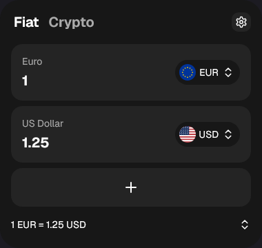

<div align="center">
  
  <h1>Numera</h1>
  <p>Currency and cryptocurrency conversion in your Firefox toolbar.</p>
  <p><a href="https://github.com/noumenonnn/numera-widget/actions/workflows/ci.yml"></a>  </p>
</div>

Numera is a compact Firefox Desktop extension for comparing fiat currencies and cryptocurrencies. It supports English and Russian, light and dark themes, editable currency lists, keyboard controls, and precise decimal calculations. No account or API key is required.

[Сведения на русском](docs/README.ru.md) · [Download 1.0.8](https://github.com/noumenonnn/numera-widget/releases/tag/v1.0.8) · [Privacy](PRIVACY.md) · [Changelog](CHANGELOG.md)

## Features

- Convert amounts across several currencies at once; add, remove, and reorder rows.
- Fiat exchange rates from Frankfurter, cryptocurrency prices from Binance, and the USDT/USD bridge from Kraken.
- Decimal arithmetic with 50 significant digits and access to the full stored precision using Alt+P.
- Cached quotes, timestamps, retry handling, and a visible indication when rates are unavailable or stale.
- Local settings and amounts; no analytics, developer backend, or remote executable code.

Availability depends on each provider and region. Quotes are informational and may be delayed; they are unsuitable as trading quotes. Fiat coverage follows the available provider rates. The extension does not run in private windows.

## Install

The GitHub ZIP is **unsigned**. For temporary installation in Firefox Desktop 140+:

1. Download and extract `numera-1.0.8.zip` from Releases.
2. Open `about:debugging#/runtime/this-firefox`.
3. Click **Load Temporary Add-on** and select the extracted `manifest.json`.
4. Open Numera from the extensions menu and pin it to the toolbar if desired.

Temporary installations end when Firefox closes. Permanent installation in Firefox Release/Beta requires Mozilla signing. An AMO listing is not yet published.

## Build and verify

Use Node.js **24.15.0** and npm **11.6.1** (see `.nvmrc` and `package.json`).

```sh
npm ci
npm run verify
npm run package
npm run package:source
```

The runtime build is in `dist/`. Upload `artifacts/numera-1.0.8.zip` to AMO and attach `artifacts/numera-1.0.8-source.zip` as source code. The source archive includes local tooling patches and the lockfile. See [reviewer instructions](docs/PUBLISHING.md).

`npm run verify` checks metadata, ESLint, TypeScript, unit tests, the production build, and Mozilla extension lint. [Browser tests](scripts/README.md) use an isolated Firefox profile. CI runs the portable checks and packages artifacts; desktop browser checks are separate. [Verification scope and known warnings](VERIFICATION.md).

## Controls

Enter an amount in a row to recalculate the others. A single `.` or `,` is the decimal separator; use spaces for digit grouping. Currency codes and catalog aliases are also accepted. Press Alt+P in an input before editing to expose full precision. On a focused currency card, Alt+Up/Down reorders it and Delete removes it; the first row is pinned. Removed rows can be restored with Undo.

## Project structure

| Path | Purpose |
| --- | --- |
| `src/` | React UI, decimal conversion, provider access, state and messaging |
| `public/` | Manifest, locales, catalog, packaged images and licenses |
| `tests/` | Unit and regression tests |
| `scripts/` | Build helpers, packaging and Firefox tests |
| `vendor/` | Auditable patches for development dependencies |
| `assets/source/` | Original source image for the lossless runtime sticker |
| `docs/` | Store descriptions, publication instructions and release notes |

## Contributing and security

Read [CONTRIBUTING.md](CONTRIBUTING.md) before opening a pull request. Report sensitive vulnerabilities using the process in [SECURITY.md](SECURITY.md). Please omit personal data from logs and screenshots.

## Rights and third-party software

Numera's original code and documentation are available under the [MIT License](LICENSE). The Numera name, logo, extension icons, brand artwork, and wheel sticker are excluded; use, copying, modification, or redistribution requires prior written permission from the relevant rights holder. Third-party licenses and attribution are listed in [THIRD_PARTY_NOTICES.md](THIRD_PARTY_NOTICES.md) and shipped in `public/licenses/`.


